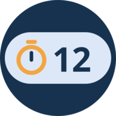
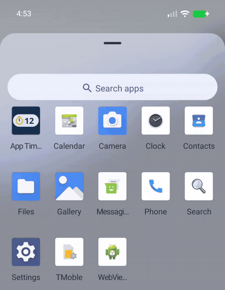
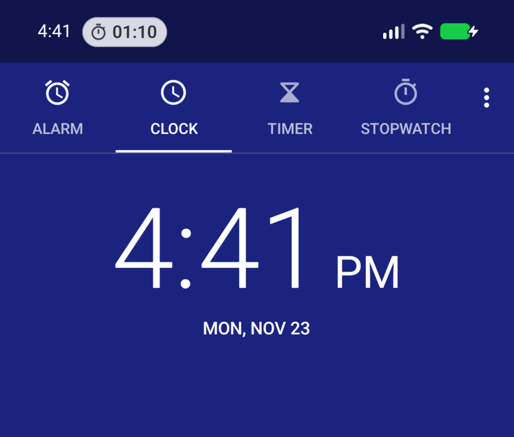
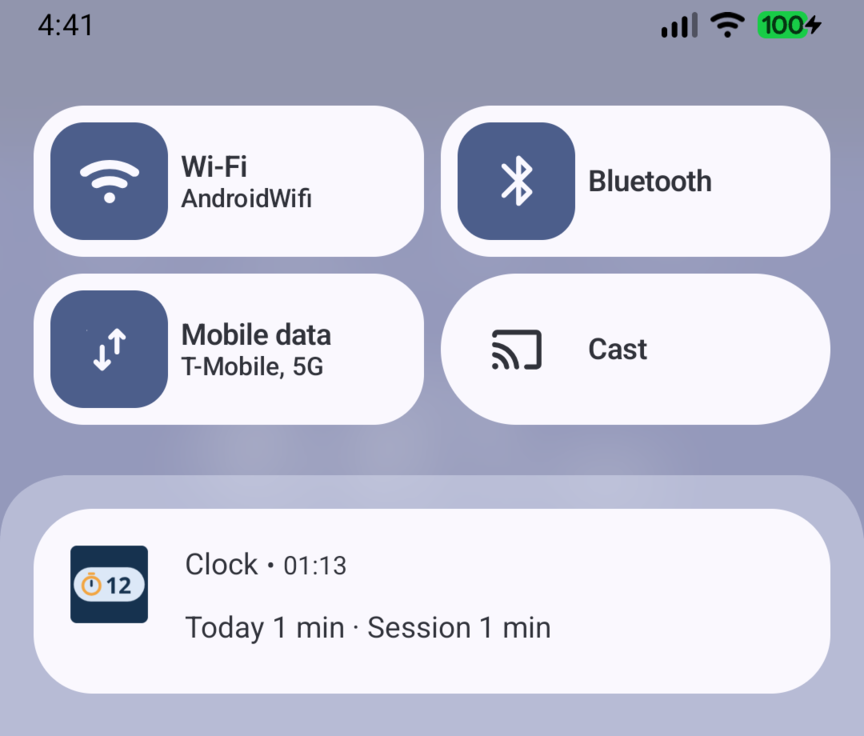
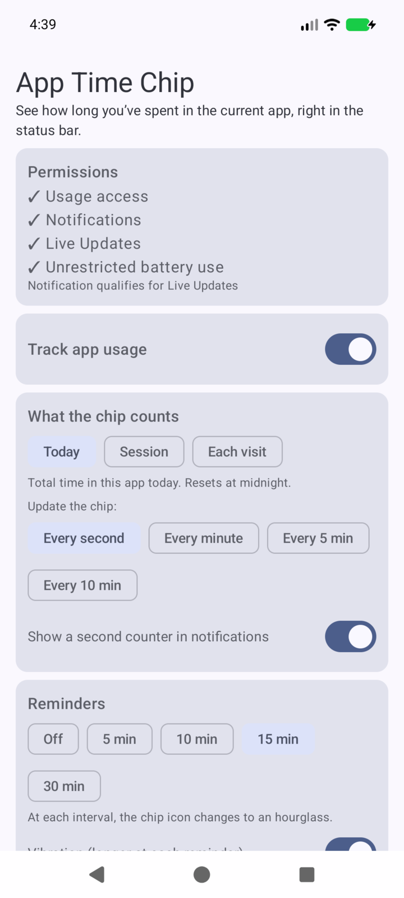

<p align="center">
  
</p>

<h1 align="center">App Time Chip</h1>

<p align="center"><strong>See how long you’ve been in an app without leaving it.</strong></p>

<p align="center">App Time Chip puts a timer next to the Android status-bar clock while you use an app you’ve chosen to track. Pick a daily total, a session timer, or a fresh counter each time you open the app. Turn on reminders if you want a nudge while you scroll.</p>

<p align="center">
  
</p>

## What you can track

| Mode | What the chip shows |
| --- | --- |
| **Today** | Total time in the app since midnight. |
| **Session** | Time in the current session. Short breaks pause the timer and keep the session open. |
| **Each visit** | Time since you last opened or returned to the app. |

Choose the apps you want to track. Each app can have its own counter mode and reminder interval. The chip can count seconds live or update every 1, 5, or 10 minutes. Enable **Show a second counter in notifications** to see two counters in the notification shade.

<p align="center">
  
  
</p>

Optional reminders repeat every 5, 10, 15, or 30 minutes on the selected counter. The chip switches to an hourglass and can vibrate, show a short message, or do both. The counter pauses when you leave the app or turn off the screen.

## Setup

The status-bar chip requires **Android 16 QPR2 or later** and depends on your phone’s support for [Live Updates](https://developer.android.com/develop/ui/views/notifications/live-update). The chip was tested on a Pixel 6a running Android 17.

1. [Build and install the app](#build-from-source).
2. Open **App Time Chip** and allow **Usage access**, **Notifications**, and **Live Updates**.
3. Turn on **Track app usage**, select at least one app, and open it to see the timer next to the clock.

If Android keeps stopping tracking in the background, allow unrestricted battery use for App Time Chip. The app supports English and Ukrainian. Android’s app language settings let you choose either language.

<p align="center">
  
</p>

Usage access lets the app identify the foreground app and calculate today’s total. Tracking runs on your device and the app requests no internet permission. Full-screen apps can hide the status bar and the timer with it. Reminders can still vibrate.

## Build from source

Use JDK 17 and the Android SDK platform for API 37 (`platforms/android-37.0`). From the repository root:

```sh
./gradlew assembleDebug
adb install -r app/build/outputs/apk/debug/app-debug.apk
```

`./gradlew lintDebug` runs Android lint. `./gradlew assembleRelease` builds a minified unsigned APK.

## How it works

The app uses Kotlin and Jetpack Compose. A foreground service reads Android usage events once a second while the screen is on. The counters run in parallel so you can switch modes without clearing the current session. A Live Update notification gives Android the timer to render in the status bar.

The idea came from [*From Awareness to Action*](https://doi.org/10.1145/3749507), a 2025 study on showing phone session duration in the status bar. App Time Chip applies the same idea to individual apps.
